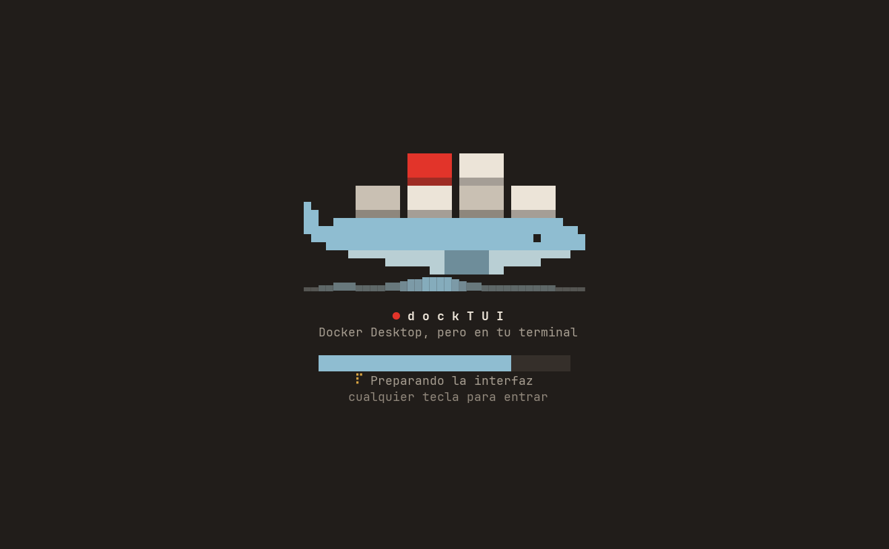
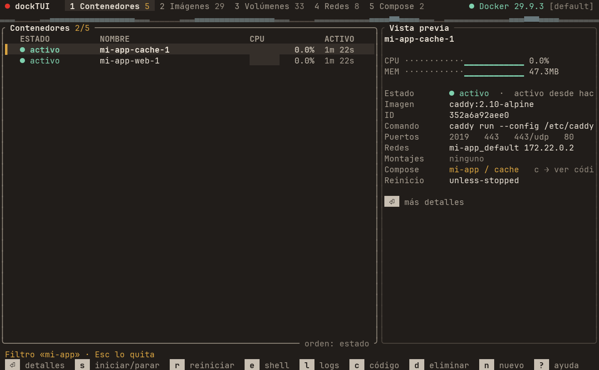
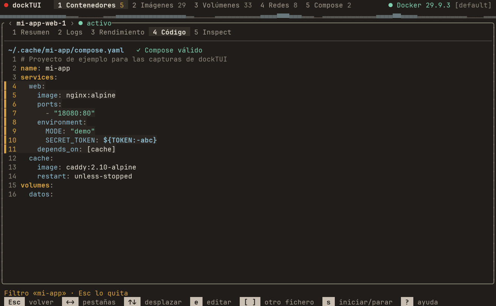
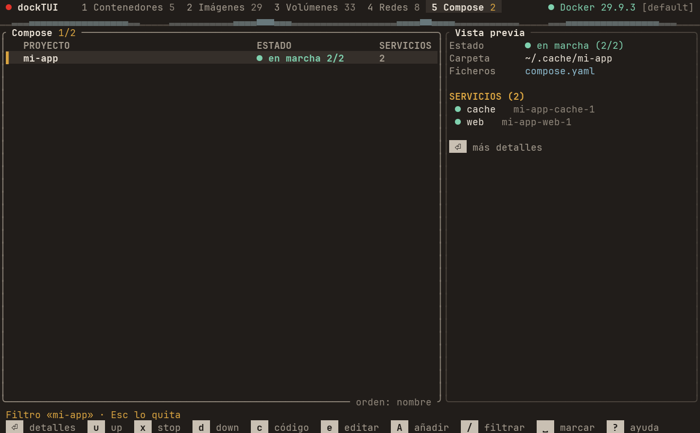
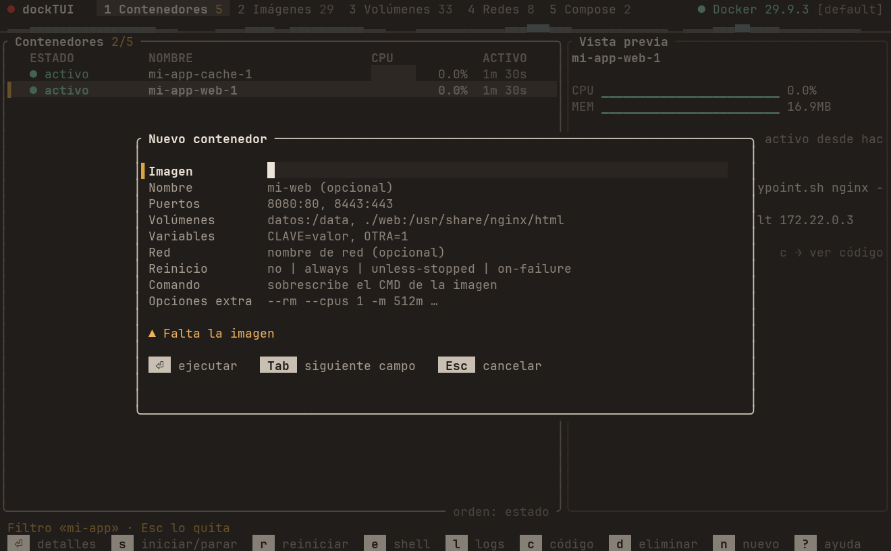

# dockTUI

Sustituto de Docker Desktop para el terminal: **contenedores, imágenes, volúmenes, redes y proyectos Compose** en una sola interfaz, con logs y métricas en vivo, y un visor de código que te lleva al `docker-compose.yaml` de cada contenedor.

Rust 2024 · Ratatui 0.30 · habla con el CLI `docker` (respeta contextos y `DOCKER_HOST`). Binario único de ~1,5 MiB, sin runtime.

| | |
|---|---|
|  |  |
|  |  |



*Capturas reales de la propia aplicación (kitty/tmux, 120 columnas) con un proyecto de ejemplo, `mi-app`, con un `nginx` y un `caddy`.*

## Instalar y usar

```sh
cargo install --path .          # o: cargo build --release && install -m755 target/release/docktui ~/.local/bin/
docktui                         # en cualquier carpeta
docktui ~/Proyectos/mi-app      # abre mostrando el compose.yaml de esa carpeta
docktui --no-anim               # sin animaciones (también DOCKTUI_NO_ANIM=1)
```

Necesita un terminal con **color verdadero** (kitty, wezterm, alacritty, foot…) y un Docker accesible para tu usuario. Si el daemon está apagado, la pantalla lo explica (con el comando para arrancarlo) y se conecta sola al volver.

## Qué hace

- **Contenedores**: iniciar/parar, reiniciar, pausar, matar, renombrar, eliminar, crear (formulario con vista previa del `docker run`), shell dentro (`e`), abrir en el navegador (`b`), logs en vivo con filtro y colores por nivel.
- **Imágenes**: descargar con progreso, construir desde un Dockerfile, etiquetar, ejecutar, eliminar, limpiar *dangling*, ver las capas con su tamaño.
- **Volúmenes y redes**: crear, eliminar, limpiar sin uso, tamaño por volumen, qué contenedores los usan.
- **Compose**: `up`, `up --build`, `stop`, `restart`, `pull`, `down`. Detecta el `compose.yaml` de la carpeta actual aunque no esté en marcha, y puedes añadir más con `A` (se recuerdan en `~/.config/docktui/compose.list`).
- **Más detalles (`⏎`)**: resumen, logs, rendimiento (CPU/memoria con gráficos), **código**, capas, inspect. Desde un contenedor de Compose, la pestaña *Código* salta al servicio, lo marca con una barra dorada, resalta la sintaxis, valida el fichero con `docker compose config` y permite abrirlo en tu `$EDITOR` en esa línea (`e`). `[`/`]` cambia entre los ficheros y el `.env`.
- **Selección múltiple** (`␣`, `a`) para actuar sobre varios elementos; **filtro** (`/`) y **orden** (`o`) por pestaña; **ratón** (clic, doble clic, rueda).
- Los valores que parecen secretos (`PASSWORD`, `TOKEN`, `KEY`…) se ocultan en el resumen.

Pulsa `?` dentro para ver todos los atajos.

## Diseño

Paleta **Ryoku Kami · Grafito**. El estado nunca va solo en color: siempre icono y texto (`● activo`, `✕ salió (137)`, `▲ no sano`). Animaciones: ola de cabecera que se agita cuando hay tareas, spinners braille, barras con destello (descargas/builds), barra indeterminada, destello de fila al cambiar de estado, splash de ballena en píxel art. `--no-anim` las desactiva.

## Cómo funciona

```
main ─ bucle de eventos (33 ms con animación, 250 ms sin ella)
 ├─ app.rs      estado puro + reducción de mensajes (Msg)
 ├─ input.rs    teclado, ratón, pegado → estado
 ├─ actions.rs  tareas (docker …), formularios, diálogos, editor/shell
 ├─ docker.rs   ejecuta `docker`, parsea `inspect`, procesos con streaming
 ├─ compose.rs  descubrimiento, servicios, resaltado YAML/.env
 └─ ui/         dibujo sin efectos (lista, detalle, diálogos, splash)
```

- Lectura: `docker inspect` por lotes en paralelo. Se refresca cuando `docker events` avisa de un cambio (ráfagas agrupadas) y cada 20 s como respaldo; si el flujo de eventos cae, sondea cada 2,5 s. En reposo ronda el 1–2 % de un núcleo.
- Las acciones lanzan `docker …` como **tareas** en segundo plano; la interfaz nunca se bloquea. El avance de `pull` y `build` es una **estimación** (capas / pasos `[n/m]`).
- Los tamaños de volúmenes salen de `docker system df -v` (lento) y se calculan aparte cada 60 s.

## Desarrollo

```sh
cargo test        # 24 pruebas: modelo, Compose, formularios y dibujo con TestBackend en 7 tamaños
cargo clippy --all-targets
```

Las pruebas de dibujo recorren todas las pestañas, los detalles, los diálogos y el estado «sin conexión» desde 1×1 hasta 220×60.

## Límites conocidos

- Verificado en Linux con Docker 29.9 + Compose 5.6, en tmux y a ojo con capturas. **No probado**: macOS/Windows, Podman, contextos remotos, Swarm/Kubernetes, otros terminales distintos de tmux/kitty, ni el ratón a mano (solo con pruebas).
- Sin login/gestión de registros, redes avanzadas ni edición de la configuración del daemon.
- `e` (shell) usa `bash` si existe en el contenedor y `sh` si no; no sirve en imágenes sin shell (*distroless*, `scratch`).

## Estado y límites

- Versión 0.1. Verificado en Linux con Docker 29.9 y terminales con color verdadero; el ratón y macOS/Windows no se han probado a mano.
- El panel de **vista previa** solo aparece con 112 columnas o más.
- Si lo lanzas desde una carpeta a la que llegas por un enlace simbólico, un proyecto Compose puede aparecer dos veces (una por la ruta real y otra por la del enlace).
- Pendiente: otros terminales, contextos remotos y Podman, y explorar los archivos de un volumen.

## Licencia

[MIT](LICENSE).
